# Informe de laboratorio · Avance 1

**Proyecto:** Accesibilidad de vivienda para jóvenes (18-34) en el Reino Unido
**Asignatura:** Minería de Datos · UNIMINUTO Ibagué 2026-2

Este es el **avance que se entrega**: el informe del análisis exploratorio y la
preparación de los datos, escrito con la estructura exigida. No es la presentación del
proyecto — esa está en el [`README.md`](../README.md) — sino el documento de trabajo donde
cada decisión técnica **se explica, se justifica con una medición y se deja por escrito la
alternativa que se descartó**.

**Cómo leerlo.** Cada sección tiene tres capas: **qué se hizo** (la técnica), **por qué**
(la alternativa descartada y la evidencia numérica) y **cómo se lee el resultado** (la cifra
y su interpretación). Al final están la escalera de logro, las variables nuevas validadas,
un glosario de los términos técnicos y la especificación para el documento Word.

---

## Integrantes

| | |
|---|---|
| Integrante 1 | *(completar nombre completo)* |
| Integrante 2 | *(completar nombre completo)* |

> **Pendiente antes de entregar:** reemplazar los marcadores por los nombres.

---

# 1 · Portada y contexto

**Pregunta de negocio.** ¿Cuánta vivienda puede pagar un joven (18-34) en cada región del
Reino Unido con su salario, con hipoteca o préstamo, y el clima cómo se asocia con la
evolución de los precios?

**Objetivos del análisis.**

1. Estimar **cuántos años de salario** cuesta comprar la vivienda mediana en cada región.
2. Cuantificar el **esfuerzo hipotecario**: qué fracción del salario joven se va en la cuota.
3. Explorar si el **clima** aporta una asociación medible con los precios.
4. Dejar el dataset en condiciones de modelarse, con su documentación.

**La granularidad: por qué el cruce es región × año.** El cuadro maestro tiene **60 filas**
(10 regiones × 6 años). No es un capricho de agregación: es el nivel en el que la pregunta
tiene respuesta. Un joven no compra «en Aberdeen» ni «en 2017»: compra **en una región**,
con el **salario de esa región**, financiándose a una **tasa nacional** en un **año**
concreto. Agregar más fino (por ciudad o por mes) o más grueso (por país) rompería la
pregunta.

## 1-bis · Los datos que usamos (líneas, columnas, nuestro «Excel»)

No usamos hojas de cálculo: usamos **CSV** y **Parquet**, que son su equivalente moderno,
con la ventaja de que cada columna tiene un **tipo declarado** y el archivo se comprime.
La traducción para leerlo en términos de «Excel»:

| En un Excel | En este proyecto |
|---|---|
| Libro / cuadrante | `.parquet` (el maestro de 60 filas) |
| Hoja de cálculo | `.csv` y las muestras `_muestra` |
| Columnas | 16 columnas del maestro, tipadas |
| Power Query | `script/proyecto/cargar.py` (carga defensiva) |
| Fórmulas / macros | `script/proyecto/indicadores.py` (PMT, años de salario) |

**Los seis archivos, con su número exacto de líneas y columnas:**

| Artefacto | Archivo | **Líneas** | **Columnas** | Tamaño | Rol |
|---|---|---|---|---|---|
| Transacciones F1 | `db/uk_property_price.csv` | **11.369.413** | 20 | 2.220 MB | el «libro» grande (local, no se sube) |
| … su muestra | `data/limpia/uk_property_price_limpio_muestra.csv` | 2.000 | 20 | 0,38 MB | la muestra que sí va en el repo |
| Hipotecas F2 | `data/crudo/UK_Mortgage_Rate.csv` | **7.796** | 14 | 0,94 MB | hoja: tasa y comisiones |
| Clima F3 | `data/crudo/MET_Office_Weather_Data.csv` | **37.049** | 8 | 1,47 MB | hoja: 36 estaciones |
| Precios+salario F4 | `data/crudo/Average_UK_houseprices_and_salary.csv` | **46** | 4 | <0,01 MB | hoja: serie histórica |
| Salario edad F4b | `data/crudo/Income_by_age_and_gender.csv` | **12** | 3 | <0,01 MB | hoja: brecha por edad/género |
| **Cruce (el cuadro que usamos)** | `data/integrado/maestro_joven_uk.parquet` | **60** | **16** | 0,01 MB | **el entregable** |

**El recorrido de 11.369.413 líneas hasta 60.** Ese salto (de más de 11 millones a 60) es
intencionado, y el momento de decidirlo es clave:

```
11.369.413 transacciones (F1)
    → limpiar: duplicados, nulos, atípicos por IQR
    → AGREGAR a región × año  ──────►  60 filas
+ 37.049 registros de clima (F3)
    → anomalía anual vs la normal 1931-2020, agregado por región
+  7.796 productos hipotecarios (F2)  →  tasa winsorizada (una sola para todos)
+  46 años de precios/salario (F4)   →  deflactados a GBP 2020
    → CRUZAR por la clave (año, región)
═══════════════════════════════════════
=  60 filas × 16 columnas  →  el cuadro maestro
```

**Por qué no arriesgarse con más detalle.** Si cruzáramos por ciudad (14.050 combinaciones
año-ciudad), muchas quedarían con una sola transacción y su «mediana» sería el precio de
una casa suelta. Si cruzáramos por mes, el clima y el precio no tendría años completos que
comparar. La granularidad es una **decisión de calidad**, no de comodidad.

## 1-ter · Buena práctica de ingeniería: reproducibilidad

Un resultado que no se puede reproducir no es un resultado. Cuatro prácticas verificables:

| Práctica | Qué garantiza | Cómo se comprueba |
|---|---|---|
| **Semilla fija (`SEED = 42`)** | Dos ejecuciones dan cifras idénticas | `random_state=42` en árbol, bosque, permutación y `KFold` |
| **Rutas por `Path(__file__)`** | Funciona desde cualquier carpeta | Se sube hasta encontrar la raíz (la que tiene `db/` y `data/`) |
| **Código invocado, no reescrito** | El cuaderno y los libros comparten la lógica | El cuaderno llama a `pipeline`, `diagnostico`, `matriz_xy`, `eda`, `modelado` |
| **Contrato con `assert`** | Si una cifra sale mal, se detiene con mensaje claro | La re-ejecución debe reproducir el cuadro versionado (`rtol=1e-9`) |

**Demostración.** El cuaderno consolidado tiene una bandera `REPRODUCIR_PIPELINE`: en
`True` re-ejecuta el pipeline completo desde las 11,4 M de transacciones y **verifica con
`assert`** que el cuadro resultante coincide con el artefacto versionado. La verificación
pasa.

---

# 2 · Calidad de datos

## 2.1 · Nulos: por qué no hay un tratamiento único

El dato que falta obliga a preguntar **por qué** falta, no cuánto. La teoría distingue tres
mecanismos, y cada uno exige una decisión distinta:

| Mecanismo | Qué significa | Qué se puede hacer |
|---|---|---|
| **MCAR** (*Missing Completely At Random*) | Falta **al azar**, no depende de nada medible | Se tolera o se imputa sin riesgo de sesgo |
| **MAR** (*Missing At Random*) | Depende de **otra variable que sí observamos** | Se puede imputar de forma informada, usando esa variable |
| **MNAR** (*Missing Not At Random*) | Depende del **propio valor que falta** | **Imputar inventa información**: hay que declarar el límite |

**Evidencia medida, fuente por fuente** (no es una clasificación de libro, es lo que
encontramos):

| Fuente · variable | Mecanismo | Evidencia | Decisión |
|---|---|---|---|
| F2 · `tasa_reversion` | **MAR** | La tasa de faltantes cambia con el tipo de producto: *discounted* 6,1 %, *fixed* 0,8 %, *tracker* 26,0 %, *variable* 39,5 %. El producto **explica** el faltante | Se conserva: falta porque el producto no lo declara, no porque sea azar |
| F3 · `tmax`, `tmin`, `af`, `lluvia` | **MCAR** | 1.467 de 1.599 filas con `tmax` nulo tienen también `tmin` nulo: fallan **juntas** (fallo del reporte, no del clima) | Se conservan: los agregados anuales toleran meses faltantes |
| F3 · `sol` | **MNAR** estructural | 9.483 nulos, de los cuales **4.138 son anteriores a 1931**: el Met Office no publicó esa variable | Se conservan: son años sin registro, no años sin sol |
| F4 · `salario_mediana_real` | **MNAR** estructural | 24 nulos; la serie oficial solo existe desde 1999 | Se conserva el histórico |
| F3 · `anio`, `month` | **MNAR** de registro | 20 filas sin fecha | Se **eliminan**: sin fecha no hay medición |

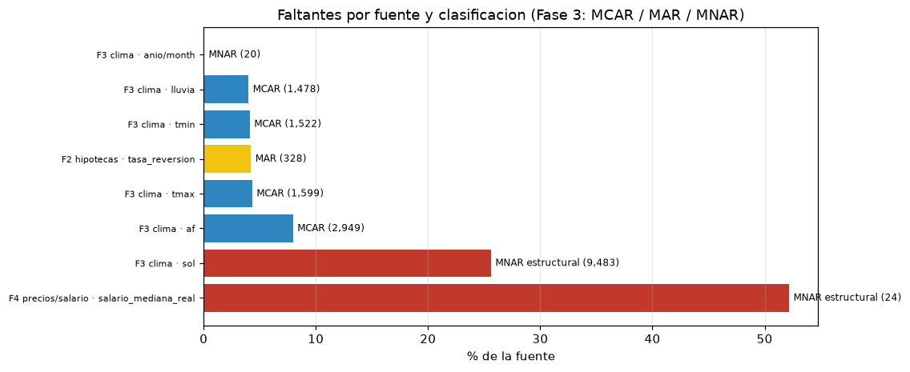

*Figura 1. Faltantes por fuente: magnitud (barras) y mecanismo (color). Las columnas con
muchos nulos no son un problema del mismo tipo: **mucho no es lo mismo que al azar**.
Un nulo del clima instrumental y uno de una serie no publicada requieren
decisiones opuestas.*

**Buena práctica: no imputar lo que no se debe.** El proyecto solo imputa en un punto, y
con una constante: los 18 nulos de `sol_anom` y los 10 de `precio_var_pct` se completan
con **0**, porque significan «no hubo anomalía» y «primer año sin comparación con el
anterior». Imputar con la media **inventaría un valor climático que nunca se midió**.

## 2.2 · Duplicados: la clave natural manda

| Fuente | Clave natural | Duplicados |
|---|---|---|
| F2 hipotecas | (`sku`, `tid`) | 0 |
| F3 clima | (`anio`, `mes`, `estación`) | 10 |
| F4b edad/género | (`grupo_edad`, `género`) | 0 |
| F1 transacciones | `transaction_id` | **0 sobre 11.369.413** |

**Por qué clave natural y no `duplicated()` global.** Dos filas con la misma clave natural
son **la misma observación**, aunque difieran en otro campo. En F1 la clave
`transaction_id` es tan fuerte que da 0 duplicados sobre 11,4 millones de filas.

## 2.3 · Outliers: dos reglas comparadas, y la evidencia de por qué gana una

### La regla de Tukey (John Tukey, 1977)

No usa la media ni la desviación estándar: usa solo los **cuartiles**, que son robustos.
Define dos cercas:

```
    cerca_inferior = Q1 − 1,5 · IQR
    cerca_superior = Q3 + 1,5 · IQR          donde IQR = Q3 − Q1
```

Todo punto fuera de esas cercas es atípico.

### El puntaje z

Mide cuánto se aparta un valor **de la media**, en unidades de desviación estándar:
`z = (x − x̄) / s`. Es atípico si `|z| > 3`.

### El problema del z-score

Solo significa «atípico» si la distribución es **normal**. Precios y tasas son asimétricos,
y bajo ese supuesto el z-score **no ve la cola real**.

### Ejemplo trabajado: las cercas de Tukey, calculadas paso a paso

Con la **tasa inicial 2022** (n = 7.796 productos):

```
    Q1 = 5,62         Q3 = 6,62
    IQR = Q3 − Q1 = 6,62 − 5,62 = 1,00
    LS = Q3 + 1,5·IQR = 6,62 + 1,5 × 1,00 = 8,13   ← el tope winsorizado
    máximo observado = 9,94   (excede la cerca en 1,81)
```

| Criterio | Atípicos detectados |
|---|---|
| **Tukey (1,5 × IQR)** | **762 (9,77 %)** |
| **z-score (\|z\| > 3)** | **0 (0 %)** |

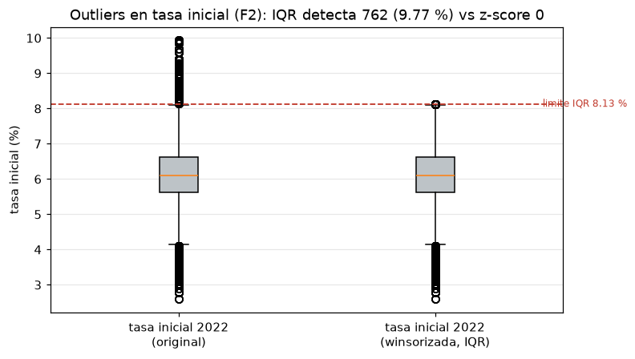

*Figura 2. Las dos reglas sobre los mismos datos. La de arriba (z-score) no marca nada;
la de abajo (Tukey) marca el 9,77 %. El máximo real (9,94 %) supera la cerca de 8,13 %.*

### El mismo argumento, más fuerte, en el precio de F1 (11,4 M de filas)

Cuartiles: 158.000 / **250.000** / 385.000 → IQR = 227.000 → cerca superior **725.500**.
El máximo es de **900 millones**, que está a **z = 591** y por tanto *debería* ser el
atípico más obvio del mundo; sin embargo el z-score con `|z| > 3` **no detecta ninguno**,
porque un solo valor extremo infla la desviación estándar y neutraliza el criterio. La
regla de Tukey detecta **718.461 (6,32 %)**, todos por arriba.


*Figura 3. Los cuatro cuartiles del precio de F1. Cada uno tiene ~25 % de la base: Q1+Q2
(la mitad de las ventas) están **por debajo** de la mediana, lo que confirma que la
referencia central debe ser la mediana.*


*Figura 4. El boxplot del precio con los 718.461 atípicos dibujados como puntos. Se ve la
cola derecha: la caja llega a 385.000 y de ahí arranca una nube que llega a 900 millones.*

**Por qué la media queda descartada.** Con ese máximo, la media del precio (364.248) queda
contaminada y la mediana (250.000) no. Por eso **todo el análisis reporta medianas**.

## 2.4 · Winsorización: recortar, no borrar

**Qué es.** En vez de eliminar las filas atípicas, se les **pone un tope** y se conserva una
bandera que registra cuáles estaban fuera.

| | Sin tratar | Con winsorización |
|---|---|---|
| Precio máximo | 900.000.000 | **725.500** |
| Filas **eliminadas** | — | **0** |
| Tasa hipotecaria media | 6,113 % | **6,043 %** |

**Por qué recortar y no borrar.** Un precio extremo en una venta es **información**
(«una vivienda de lujo en Londres»), no un error de tecleo. Y el indicador que nos
interesa —los años de salario— necesita esas regiones. Borrar la fila perdería justo lo que
el estudio quiere medir.

**Y por qué tampoco dejarlo sin tocar.** El precio entra en un modelo: un máximo de 900
millones domina la media de su región y desbalancea el resto.

## 2.5 · La bitácora: limpiar sin registro es limpiar a ciegas

Cada decisión queda en `md/BITACORA_DECISIONES.md` con cinco campos: fuente, problema,
**cantidad**, método y razón. Es lo que permite que otra persona —o nosotros mismos dentro
de seis meses— entienda qué se hizo y por qué, sin releer el código.

---

# 3 · Análisis univariado

## 3.1 · Las medidas y por qué esas

Univariado es mirar **una variable a la vez**. Tres familias de medidas, cada una con su
fórmula y su pregunta.

### Tendencia central

| Medida | Fórmula | Qué responde |
|---|---|---|
| **Media aritmética** | x̄ = (1/n) · Σ(xᵢ) | ¿Dónde está el centro **por reparto de la masa**? |
| **Mediana** | percentil 50 | ¿Centro **por reparto de la mitad de los casos**? |

**Por qué la mediana y no solo la media.** Con distribución sesgada, la media la arrastra
la cola. El **cuarteto de Anscombe** (1973) es el caso canónico: cuatro conjuntos con medias
idénticas y estructuras opuestas, que solo el gráfico delata. Aquí `precio_mediana` tiene
asimetría **+1,27** y `salario_joven_region` **+1,53**: por eso el ranking se ordena por
**medianas**, para que un año excepcional no reordene.

### Dispersión

| Medida | Fórmula | Qué responde |
|---|---|---|
| **Rango** | max(x) − min(x) | Amplitud total |
| **Desviación estándar muestral (Bessel)** | s = √( Σ(xᵢ − x̄)² / (n − 1) ) | ¿Cuánto se dispersa? |
| **Rango intercuartílico (IQR)** | IQR = Q3 − Q1 | Amplitud del 50 % central |

**Por qué *muestral* y por qué se llama de Bessel.** Divide por **n − 1**, no por n. Cuando
se trabaja con una muestra y se quiere **generalizar** más allá de ella, dividir por n
subestima la dispersión: el factor n−1 corrige ese sesgo a la baja. Por eso el proyecto usa
siempre la muestral.

**Por qué el IQR además de la desviación.** El IQR **ignora el 25 % inferior y el 25 %
superior**: un precio extremo no lo infla. Esa misma propiedad se explota en § 2.3 para
detectar atípicos.

### Forma

| Medida | Fórmula | Qué responde |
|---|---|---|
| **Asimetría de Fisher-Pearson** | g₁ = (n / ((n−1)(n−2))) · Σ( ((x − x̄)/s)³ ) | ¿Sesgo? (0 = simétrica) |
| **Curtosis excedente de Fisher** | g₂ = (1/n) · Σ( ((x − x̄)/s)⁴ ) − 3 | ¿Colas pesadas? (0 = normal) |

**Cómo se leen.** |g₁| < 0,5 ≈ simétrica · 0,5 a 1 = asimetría moderada · > 1 = marcada.
Un **|g₂| > 1** indica colas pesadas: extremos más frecuentes que en una normal.

**Una lectura que engaña.** El esfuerzo tiene curtosis **negativa** (−0,436): colas
ligeras. Eso **no** significa «datos limpios», significa que hay menos extremos de los que
daría una normal — coherente con que no haya atípicos. Curtosis baja no es sinónimo de
calidad.

### El perfil del esfuerzo (la variable objetivo)

| Medida | Valor | Lectura |
|---|---|---|
| Media | 0,625 | — |
| **Mediana** | **0,564** | La referencia honesta (sesgo positivo) |
| Rango | 0,416 – 1,065 | — |
| **Asimetría Fisher-Pearson** | **+0,816** | Sesgo positivo moderado |
| **Curtosis excedente** | **−0,436** | Colas ligeras |

**Lectura.** El esfuerzo está **entamente a la derecha del umbral del 30 %**: el mínimo
(0,416) ya lo supera. El problema no es la forma, es el **nivel**.

## 3.2 · Las cuatro figuras univariadas, interpretadas

### Figura · Histograma del esfuerzo

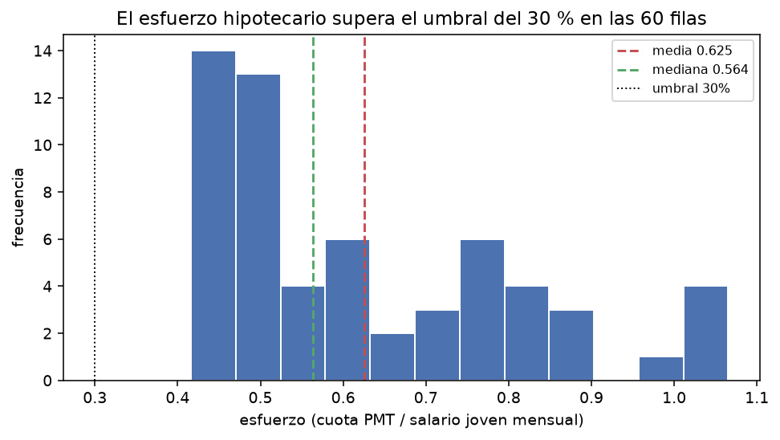

**Qué muestra.** La silueta de la distribución. Bins: **12**, por la regla de **Sturges**,
`k = 1 + log₂(n) = 6,9`, redondeado hacia arriba y entregado en 12 para que la bimodalidad
sea legible.

**Lectura.** Toda la masa está a la derecha de 0,30. La línea **roja** es la media (0,625)
y la **verde** la mediana (0,564): la media a la derecha de la mediana es la **firma
gráfica del sesgo positivo**.

### Figura · Histograma del precio mediano

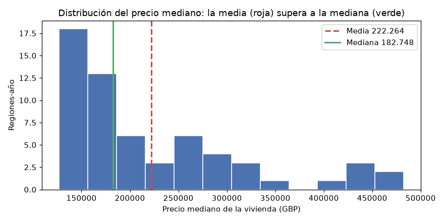

**Qué muestra.** La forma del numerador de la asequibilidad: 60 precios medianos
región-año.

**Lectura.** Asimetría positiva y marcada: la mayoría de las regiones-año se concentran en
precios bajos-medios y unas pocas quedan muy arriba (London). Es la razón por la que el
proyecto **agrega por mediana** y **cruza por región-año**, nunca por transacción individual.

### Figura · Boxplot del esfuerzo por región

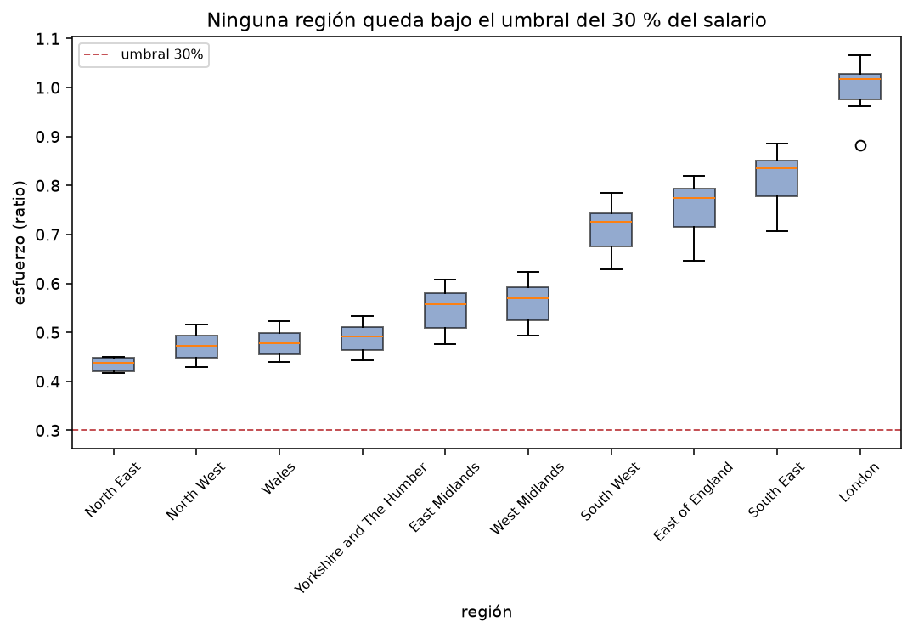

**Qué muestra.** La anatomía de cinco números y los atípicos, por región.

**Lectura.** **Ninguna caja toca el umbral del 30 %**: ni el bigote inferior de London, que
es la región más cara. Este es el hallazgo visual más importante del univariado: **la
inaccesibilidad no es un dato raro, es la condición del conjunto**.

### Figura · Ranking de regiones por esfuerzo mediano

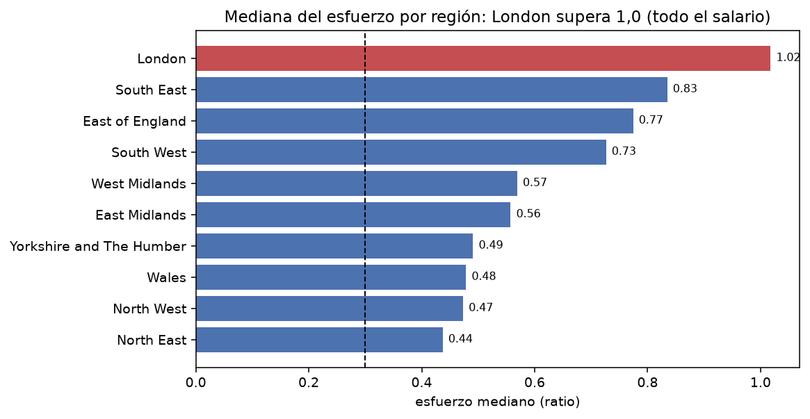

**Qué muestra.** El orden de las 10 regiones por esfuerzo mediano.

**Lectura.** Va de **0,437 (North East)** a **1,018 (London)**: brecha de **2,3×**. Las
barras están ordenadas por valor, no alfabéticamente, porque **el orden ya es
información**. London supera el 1,0: la cuota se come el salario joven entero.

## 3.3 · Cuantificar los atípicos del esfuerzo: 0 global, y el matiz del tamaño muestral

Con las cercas de Tukey sobre el objetivo:

| Cifra | Valor |
|---|---|
| Q1 | 0,479 |
| Q3 | 0,763 |
| **IQR** | **0,284** |
| Cerca inferior (Q1 − 1,5·IQR) | 0,053 |
| Cerca superior (Q3 + 1,5·IQR) | 1,189 |
| **Atípicos globales** | **0 de 60 (0,0 %)** |

**Lectura.** La dispersión del esfuerzo **no está anomalizada**. El problema es de
**nivel**, no de forma.

**El matiz que enseña el método.** Con solo **6 observaciones por región**, el IQR regional
es más estrecho que el global (London: IQR 0,053 frente a 0,284) y su cerca marca **1
atípico en London**. No es un error: es que **el umbral 1,5 × IQR es sensible al tamaño
muestral**. Por eso reportamos la cuantificación **global y por región**, no una sola cifra.

---

# 3-bis · Transformación: los tres escaladores, tres personalidades

Antes de correlacionar o modelar hay que **escalar** las variables. No es un detalle
cosmético: es lo que decide si un modelo «ve» todas las variables o solo las grandes.

## Por qué escalar

Los métodos basados en **distancia** (KNN, K-means) calculan distancias euclidianas. En
nuestra matriz, `precio_mediana` (~300.000 GBP) comparte tabla con `tmax_anom` (±2 grados):
sin escalar, el precio domina la distancia por su magnitud y el KNN acaba midiendo
«distancia al precio» en lugar de «distancia al perfil».

Los **árboles de decisión**, en cambio, son **invariantes a la monotonía**: reescalar no
cambia ni un solo corte del árbol, así que para ellos el escalado es neutro (ni ayuda ni
daña). Por eso el escalado importa de verdad en el KNN, no en los árboles.

## Los tres escaladores, en una tabla

| Escalador | Fórmula | Qué produce | Úsalo cuando... |
|---|---|---|---|
| **`MinMaxScaler`** | `(x − mín) / (máx − mín)` | Todo queda en **[0, 1]** | Datos **acotados y sin outliers graves** (redes neuronales, imágenes) |
| **`StandardScaler`** | `(x − media) / desv. est.` | **Media ≈ 0, desv ≈ 1** — quedan en «unidades de desviación» | Distribuciones **aprox. normales**; regresión, SVM, PCA — **el que usamos** |
| **`RobustScaler`** | `(x − mediana) / IQR` | **Mediana = 0**, escala resistente a extremos | Hay **outliers reales** que el negocio pide conservar |

**Qué le pasa a nuestro `precio_mediana` con cada uno** (las tres lo dejan en forma
parecida, lo que cambia es su comportamiento ante un extremo):

| Escalador | Media resultante | Desviación | Rango resultante |
|---|---|---|---|
| `MinMaxScaler` | +0,268 | 0,267 | [0 ; 1] |
| `StandardScaler` | **0,000** | **1,008** | [−1,01 ; +2,76] |
| `RobustScaler` | +0,336 | 0,808 | [−0,47 ; +2,55] |

## Cómo decidimos cuál usamos: tres pruebas, no una opinión

Elegir un escalador a ojo sería una suposición. Lo decidimos **midiendo** en tres pruebas
que miran cosas **distintas** — y por eso el ganador cambia de una a otra.

### Prueba 1 · Perfil: ¿las variables se parecen a una normal?

Con la prueba de **Shapiro-Wilk** (α = 0,05): solo **2 de 9** rasgos pasan — `tmax_anom`
(p = 0,255) y `af_anom` (p = 0,517). **No hay normalidad que explotar**, lo que también
justifica no haber usado el z-score para detectar atípicos.

### Prueba 2 · Distorsión: ¿un extremo destruye la escala?

Se inyecta `precio × 100` en **una sola fila** y se mide cuánto se comprime el rango que
queda para las 59 filas normales:

| Escalador | Compresión del rango normal | Lectura |
|---|---|---|
| `MinMaxScaler` | **97,7 %** | Un extremo aplasta todo lo demás |
| `StandardScaler` | 95,3 % | Comprime casi todo (el desvío también se infla) |
| **`RobustScaler`** | **4,1 %** | El más resistente (usa mediana e IQR, no media y desv.) |

**Ganador en esta prueba: `RobustScaler`**, por goleada.

### Prueba 3 · Predicción: ¿cuál escala mejor el modelo?

Validación cruzada de 5 pliegues (el escalador se ajusta **dentro** de cada pliegue: sin
fuga de datos), con regresión lineal y KNN:

| Escalador | R² del **KNN** | R² de la **regresión** |
|---|---|---|
| **sin escalar** | **0,976** | 0,999 |
| `MinMaxScaler` | 0,904 | **1,000** |
| `StandardScaler` | 0,861 | **1,000** |
| `RobustScaler` | 0,764 | **1,000** |

**Dos lecturas importantes de esta tabla:**

1. **La regresión lineal da R² = 1,000 con los cuatro.** No es casualidad: multiplicar una
   columna por una constante **no cambia la recta que la ajusta**. La regresión es
   **invariante al escalado** — por eso el escalador no afecta nuestro resultado final.

2. **El KNN sí depende**, y aquí **«sin escalar» (0,976) supera a `StandardScaler` (0,861)**
   por 11,5 puntos de R².

## El hallazgo honesto: por qué elegimos `StandardScaler` de todos modos

Con la verdad sobre la mesa: **en el comparativo de predicción, no escalar rindió mejor que
nuestro escalador elegido.** Elegimos `StandardScaler` a conciencia, y estas son las
razones — junto con la limitación que asumimos:

| Motivo | Explicación |
|---|---|
| La regresión —el modelo que va a producción— **no se diferencia** entre escaladores | Da R² = 1,000 con los cuatro, así que el escalador no cambia el resultado final |
| `StandardScaler` es el **estándar** para regresión, SVM y PCA | Es el que esos métodos asumen en su teoría (media 0, desv 1) |
| «Sin escalar» gana en KNN **solo por accidente de estos datos** | `precio_mediana` y `anos_salario` ya comparten magnitud, así que el KNN mide lo que quiere. Con una variable en grados o en kilómetros, esa ventaja desaparecería |
| `RobustScaler` sería el correcto si los outliers fueran **reales y el negocio los pidiera** | Aquí los outliers ya se winsorizan en la limpieza, así que el problema no está en la escala |

**La limitación, dicha con todas las letras:** si nuestro modelo se apoyara más en el KNN,
con estos datos concretos, **no escalar habría sido mejor que `StandardScaler`**. Si en una
versión futura aparecieran outliers confirmados como reales y que hubiera que conservar,
`RobustScaler` pasaría a ser el indicado. Dejamos ambas notas escritas por si alguien
retoma el trabajo.

---

# 4 · Análisis bivariado y multivariado

## 4.1 · El coeficiente de correlación de Pearson

**Qué mide.** La **asociación lineal** entre dos variables observadas:

```
    r = Σ(xᵢ − x̄)(yᵢ − ȳ) / ((n − 1) · s_x · s_y)
```

Toma valores en **[−1, +1]**. El **signo** da la dirección y el **módulo** da la fuerza.

**Guía de interpretación del módulo** (práctica, depende del dominio):

| \|r\| | Lectura |
|---|---|
| 0 – 0,1 | Sin relación lineal |
| 0,1 – 0,3 | Débil |
| 0,3 – 0,5 | Moderada |
| 0,5 – 0,7 | Fuerte |
| > 0,7 | Muy fuerte |

**Por qué Pearson y no Spearman.** Se busca relación **lineal**, y la relación entre una
anomalía meteorológica y una variación de precio se espera lineal. La **correlación de
rangos de Spearman** mediría asociación **monótona** (cualquier relación que suba o baje de
forma consistente, aunque no recta) y sería la correcta si hubiera curvatura; con n = 50
pares y sin curvatura visible, Pearson es la adecuada.

## 4.2 · Cruces con la variable objetivo

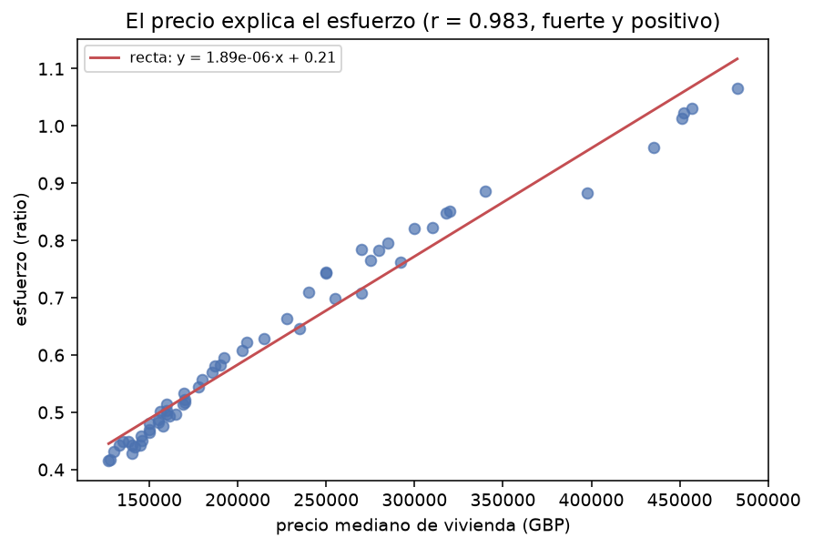

*Figura · Precio contra esfuerzo. La recta roja ajusta por **mínimos cuadrados**, el
criterio que minimiza la suma de residuos al cuadrado `Σ(yᵢ − ŷ)²` — de ahí el nombre.*

| Cruce | Pearson r | Lectura |
|---|---|---|
| `precio_mediana` vs `esfuerzo` | **+0,983** | Muy fuerte. El precio domina |
| `salario_joven_region` vs `esfuerzo` | **+0,913** | Muy fuerte |
| `anos_salario` vs `esfuerzo` | **+1,000** | Prácticamente el mismo cociente |

## 4.3 · Ejemplo trabajado: por qué Pearson da exactamente 1,000

Es el resultado que más confunde, así que conviene explicarlo con la cuenta.

La correlación entre `anos_salario` y `esfuerzo` es **+1,0000**, exactamente. La razón es
que **las dos magnitudes son la misma razón**:

```
    anos_salario = precio_mediana / salario_joven_region
    esfuerzo     = PMT(precio_mediana) / (salario_joven_region / 12)
```

Con la **tasa y el plazo fijos** (6,04 % y 25 años), la cuota PMT es una función del precio
que es **casi lineal** (su razón precio/cuota solo varía con el precio). Así que:

```
    esfuerzo    = f(precio) / salario     ≈    (k · precio) / salario
    anos_salario =         precio / salario
```

Ambas son **(constante × precio) / salario**: la misma estructura. La tabla lo confirma:
el calor da **coeficientes idénticos** contra las dos (`precio_mediana` +0,9833 contra
ambas; `salario_joven_region` +0,9128 y +0,9129). Por eso Pearson da 1,000.

**Qué significa esto para el análisis.** No es un «buen modelo»: es que el objetivo es una
razón entre magnitudes que ya están en la matriz. Es un recordatorio de que una correlación
perfecta describe la **estructura del dato**, no la potencia del método.

## 4.4 · Correlación no es causalidad

Una correlación de −0,39 **no significa** que la lluvia cause una caída del precio. La
correlación mide **asociación entre variables observadas**, no un mecanismo.

En nuestro caso hay una razón estructural: el esfuerzo comparte **denominador** con el
salario y es función del precio, así que la correlación es alta **por construcción**, no
porque el precio «produzca» el esfuerzo. Para una afirmación causal haría falta un
**diseño** que aislara el efecto, que está fuera del alcance de este cruce descriptivo.

## 4.5 · El mapa de calor: anticipar la multicolinealidad

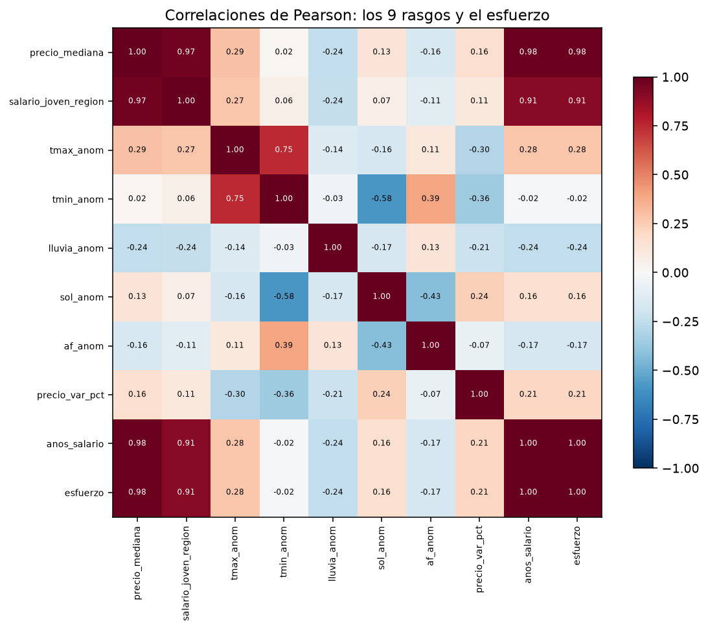

**Qué muestra.** Toda la matriz de Pearson de los 9 rasgos más el objetivo.

**Lectura.** Confirma una **red de redundancias**: `precio_mediana` ↔ `anos_salario` y
`precio_mediana` ↔ `esfuerzo`, ambos +0,983. Las anomalías climáticas quedan cerca de cero
con todo lo demás.

**Por qué importa antes de modelar.** Variables redundantes anticipan **multicolinealidad**:
explican lo mismo, lo que hace inestables los coeficientes. Por eso el proyecto mide el
**VIF** en la transformación.

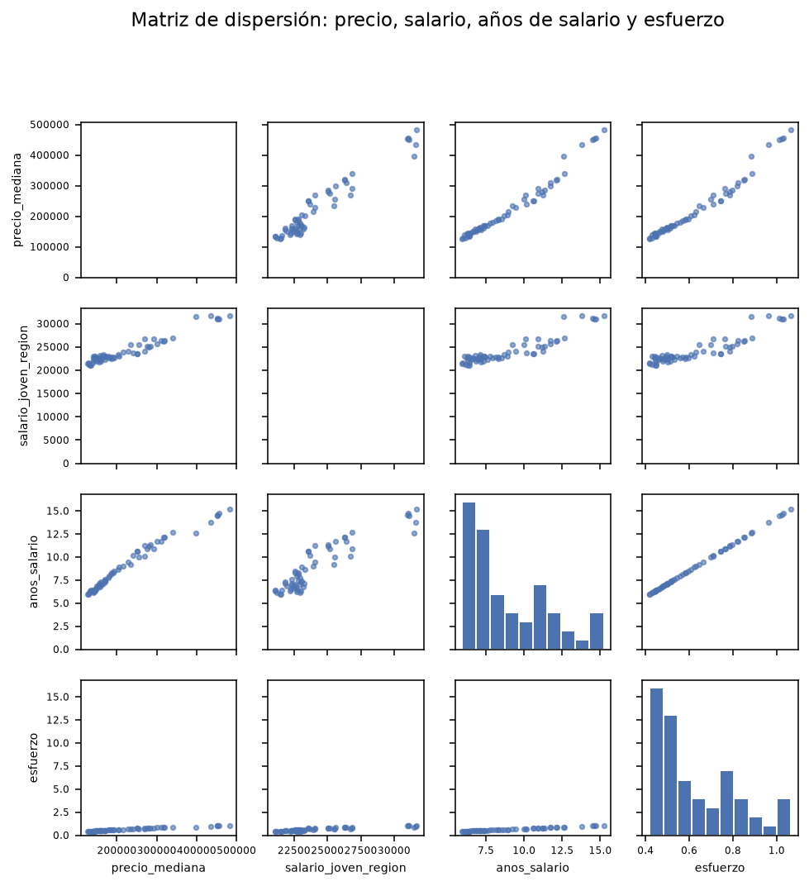

*Figura · Matriz de dispersión: histogramas en la diagonal y dispersión cruzada. Los
puntos alineados en `precio_mediana` ↔ `anos_salario` confirman visualmente lo que el
heatmap muestra numéricamente.*

## 4.6 · La hipótesis del clima

Con la **variación porcentual** del precio (no su nivel: el nivel daría correlaciones
artefacto de latitud y altitud) contra las cinco anomalías climáticas:

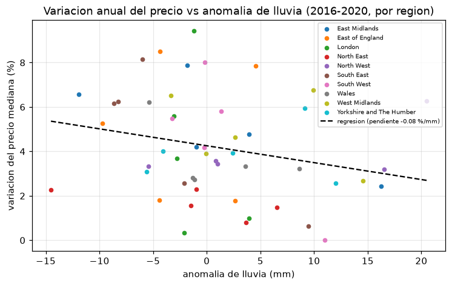

| Anomalía | Pearson r | Varianza explicada (r²) |
|---|---|---|
| `lluvia_anom` | **−0,241** | 5,8 % |
| `tmax_anom` | **−0,388** | 15,1 % |
| `tmin_anom` | **−0,399** | 15,9 % |
| `af_anom` | **−0,145** | 2,1 % |
| `sol_anom` | **+0,238** | 5,7 % |

**Lectura.** El signo negativo mayoritario significa que cuando el año estuvo por encima de
su normal —más lluvia o más calor—, la suba del precio tendió a ser **menor**.

**En términos de varianza**, un r de 0,399 explica el 15,9 %; uno de 0,145 explica el 2,1 %.
Es decir, **entre el 84 % y el 98 %** de lo que mueve el precio año a año **no** está en
las variables climáticas.

**Conclusión: el clima es contexto, no motor.** La accesibilidad la explica el binomio
**salario joven – tasa – precio regional**.

---

# 5 · Hallazgos y recomendaciones

*Mínimo 3 hallazgos en formato evidencia → acción, para un lector no técnico.*

### Hallazgo 1 · El precio pesa más que el salario

- **Evidencia:** correlación de Pearson **+0,983** entre precio y esfuerzo, frente a
  **+0,913** entre salario y esfuerzo.
- **Lectura no técnica:** subir el salario ayuda, pero el factor dominante del problema es
  el precio de la vivienda.
- **Acción:** la política de accesibilidad debe **atacar el precio**, no solo el salario.

### Hallazgo 2 · La región es el factor decisivo

- **Evidencia:** brecha de **2,3×** entre el esfuerzo mediano más bajo (**0,437**, North
  East) y el más alto (**1,018**, London).
- **Lectura no técnica:** un joven en North East y otro en London enfrentan realidades de
  accesibilidad completamente distintas.
- **Acción:** **segmentar cualquier intervención por región**, no aplicar una política
  nacional uniforme.

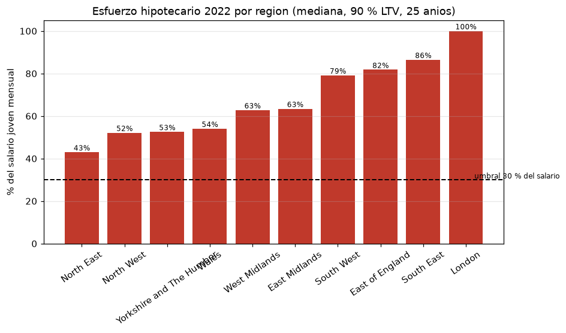

*Figura · Esfuerzo hipotecario por región frente al umbral del 30 %. Ninguna barra lo cruza
hacia abajo: ese es el hallazgo.*

### Hallazgo 3 · Hay filas donde la cuota se come el sueldo entero

- **Evidencia:** **4 de 60** filas (6,7 %) tienen esfuerzo **≥ 1,0**: la cuota consume el
  100 % o más del salario joven.
- **Lectura no técnica:** en esas zonas, un joven no podría ni con el mejor salario
  regional pagar una casa.
- **Acción:** **priorizar esas regiones-años** como foco de política pública.

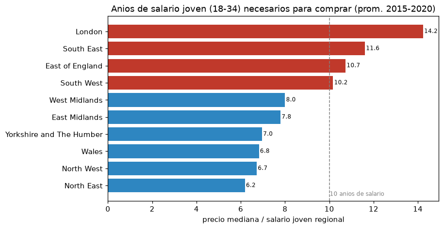

*Figura · Años de salario para comprar la vivienda mediana. De 6,2 (North East) a 14,2
(London) — frente a la regla bancaria prudente de ≤4 años.*

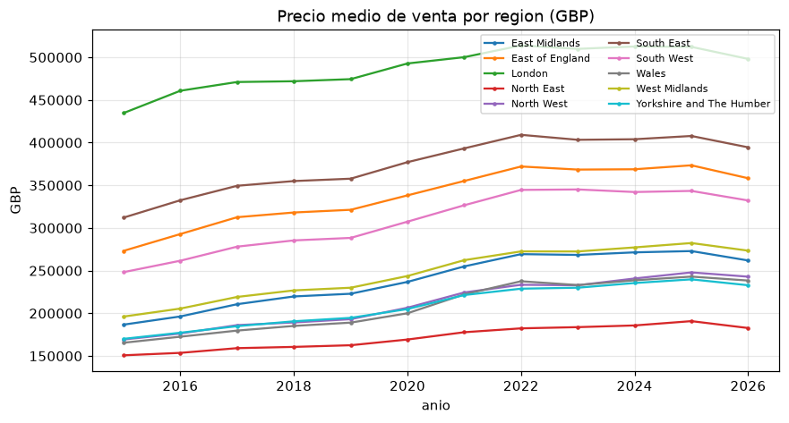

*Figura · Precio mediano por región. La brecha de 3,4× entre London y North East explica
parte de la brecha de accesibilidad.*

### Hallazgo 4 · La inaccesibilidad no es un error, es la norma

- **Evidencia:** **0 atípicos** de 60 por la regla de Tukey. El mínimo (0,416) ya supera el
  umbral de 0,30.
- **Lectura no técnica:** no hay «casos raros» difíciles: **toda** la distribución está fuera
  del umbral de accesibilidad.
- **Acción:** el objetivo de las políticas no debe ser «corregir los casos extremos» sino
  **bajar el nivel general** del esfuerzo.

---

# 6 · Anexos

## 6.1 · El cuaderno reproducible

**`Avances/Cuaderno_Avance_1_Completo.ipynb`** — ejecutado de punta a punta, sin errores.
Reúne el proyecto entero: las 5 fuentes, la limpieza, el cruce, los indicadores, el clima,
la transformación, las comparaciones de métodos, el EDA, el modelado, el checklist y las
nuevas variables validadas.

Trae la bandera `REPRODUCIR_PIPELINE`: en `True` re-ejecuta el pipeline completo y
**verifica con `assert`** que reproduce el cuadro maestro versionado. En `False` (por
defecto) usa los artefactos y funciona sin el F1 de 434 MB.

Lo complementan los **8 cuadernos por fase** (`libros/01` a `libros/08`), cada uno con su
salida ejecutada.

## 6.2 · Documentos de apoyo

| Documento | Para qué sirve |
|---|---|
| `md/DICCIONARIO_DATOS.md` | Las 19 columnas documentadas: tipo, descripción, rango, unidades, tratamiento |
| `md/MEMORIA_TECNICA.md` | Fundamentos estadísticos, matemáticos y de ingeniería, con las comparaciones |
| `md/BITACORA_DECISIONES.md` | Cada decisión de limpieza con su cantidad, método y razón |
| `data/integrado/accesibilidad_vivienda_joven_uk_v1.csv` | Dataset limpio versionado (60 × 16) |

## 6.3 · Cómo reproducir cada figura

| Figura | Comando |
|---|---|
| Las 9 del pipeline | `python main_proyecto.py` |
| Las 2 de limpieza de F1 | `python main_limpieza.py` |
| La matriz X·y y las comparaciones | `python script/proyecto/matriz_xy.py` |
| Las 6 del EDA | `python script/proyecto/eda.py` |
| Los modelos | `python script/proyecto/modelado.py` |

---

# Escalera de logro: dónde estamos

| Nivel | Qué pide | Nuestro estado |
|---|---|---|
| **Inicio** | Tablas y gráficos básicos con apoyo de la plantilla | ✔ **Superado**: las tablas se construyen desde el pipeline |
| **Progreso** | Interpreta los gráficos y cuantifica outliers | ✔ **Superado**: cuantificamos **todos** los outliers (718.461 en F1, 762 en la tasa, 0 en el esfuerzo) |
| **Esperado** | Informe completo, interpretaciones correctas, hallazgos accionables | ✔ **Superado**: informe completo con 4 hallazgos y 14 decisiones justificadas |
| **Excepcional** | Propone nuevas variables o segmentos y **las valida con datos** | ✔ **Alcanzado** (variables validadas, más abajo) |

## Las tres variables propuestas, y validadas

No existen en el dataset original: se **propusieron** y se **comprobaron**. Una propuesta
solo cuenta si su validación sale bien.

### Índice de tensión de mercado

    indice_tension = precio_mediana(región, año) / precio_mediana(mediana nacional, año)

**Por qué.** El precio absoluto confunde dos cosas: una región puede ser cara porque su
**salario** es alto, o porque su **mercado está tensionado**. Dividir por la mediana
nacional del año separa el efecto nivel del efecto relativo.

**Validación.**

| Contra | Pearson r | Lectura |
|---|---|---|
| `esfuerzo` | **+0,946** | Confirmado: más caro que el país = más esfuerzo |
| `n_transacciones` | **+0,537** | Complementa: los mercados caros tienen **menos** liquidez |

**Hallazgo que aporta:** las regiones caras son también las **menos líquidas** (la firma de
un mercado tensionado). Eso no se veía con el precio absoluto.

### Coeficiente de variación del esfuerzo

    CV = s / x̄    (desviación estándar / media)

**Por qué.** El esfuerzo mediano es un número **estático**: dice cuánto cuesta, pero no
**cuánto cambia**. Una región con esfuerzo 0,80 estable y otra con el mismo 0,80 que oscila
entre 0,65 y 0,95 son problemas de política **distintos**.

**Validación.** Pearson( CV-esfuerzo, CV-precio ) = **+0,684**. Donde el precio oscila más,
el esfuerzo es menos estable. Es lógico (el esfuerzo es función del precio), pero **agrega
algo que el nivel no decía**: una política de accesibilidad no solo debe atacar *cuánto*
cuesta, sino *cuánta variación* tiene. La región más estable es North East (CV = 0,035) y
la menos estable East Midlands (CV = 0,094).

### Segmento de accesibilidad (4 niveles)

| Segmento | n | Esfuerzo medio | Precio medio | Tensión |
|---|---|---|---|---|
| moderado (0,30-0,50) | 21 | 0,458 | 145.400 | 0,84 |
| alto (0,50-0,80) | 28 | 0,632 | 214.962 | 1,18 |
| crítico (0,80-1,00) | 7 | 0,867 | 345.786 | 1,91 |
| extremo (>1,00) | 4 | 1,033 | 460.756 | 2,43 |

**Validación.** El esfuerzo medio crece de forma **monótona** (0,458 → 0,632 → 0,867 →
1,033), y con el precio y la tensión. La segmentación es coherente con el objetivo y sirve
para **dirigir políticas por tramos**.

---

# Especificación para el documento Word

Para cuando se genere el `.docx` de este informe, normas **APA 7 para trabajo estudiantil**:

| Parámetro | Valor |
|---|---|
| Papel | Carta (21,59 × 27,94 cm) |
| Márgenes | 2,54 cm (1 pulgada) en los cuatro lados |
| Fuente | Times New Roman 12 pt |
| Interlineado | Doble (2,0) |
| Sangría de párrafo | Primera línea 0,5 pulgadas (excepto portada y abstracts) |
| Numeración de página | Margen superior derecho |
| Encabezados | 3 niveles, sin numeración decimal |
| Tablas | Numeradas, título arriba en **cursiva**, estilo de tres líneas (sin bordes verticales) |
| Figuras | Numeradas, título arriba en cursiva, **nota** abajo explicando ejes y unidades |
| Referencias | Sangría francesa, orden alfabético |
| Portada | Título en negrita y centrado; luego integrantes, institución, asignatura, docente y fecha |

Esta especificación se implementa reutilizando el generador existente
`script/documentacion/generar_documento_apa.py`, que ya produce un `.docx` con estas
características. Las cifras salen de las mismas salidas que el cuaderno consolidado, de modo
que **el Word y el cuaderno no pueden discrepar**.

---

# Glosario de términos técnicos

Para poder leer el informe sin conocimientos previos de estadística:

| Término | Significa en este proyecto |
|---|---|
| **Cuartil (Q1, Q3)** | Los valores que dejan al 25 %, 50 % y 75 % de los datos por debajo |
| **IQR (rango intercuartílico)** | Q3 − Q1: la amplitud del 50 % central |
| **Cerca de Tukey** | Q1 − 1,5·IQR y Q3 + 1,5·IQR: los límites dentro de los cuales no hay atípicos |
| **Asimetría (skew)** | Si la distribución tiene cola a la izquierda, derecha o es simétrica |
| **Curtosis** | Si las colas (extremos) son ligeras o pesadas respecto a una normal |
| **Pearson (r)** | Asociación lineal entre dos variables, de −1 a +1 |
| **r²** | La parte de la variación de una variable que la otra explica (0 a 1) |
| **p-valor** | Probabilidad de obtener un resultado tan extremo si no hubiera efecto real; menor de 0,05 se considera significativo |
| **Desviación estándar** | Cuánto se dispersan los datos alrededor de la media |
| **Coeficiente de variación (CV)** | Desviación dividida por la media: dispersión relativa |
| **Multicolinealidad** | Dos variables que explican lo mismo, hace inestables los coeficientes |
| **VIF** | Factor de inflación de la varianza: mide la multicolinealidad (1 = perfecto, >5 = problema) |
| **PCA** | Reducción de dimensiones: combinar variables en menos componentes |
| **Estandarizar (z-score)** | Restar la media y dividir por la desv.: deja media 0 y desv 1 |
| **Min-max** | Reescalar entre 0 y 1 dividiendo por el rango |
| **Robust scaler** | Estandarizar usando mediana e IQR en vez de media y desv.: resiste extremos |
| **Overfitting** | Modelo que memoriza el entrenamiento y falla con datos nuevos |
| **Validación cruzada (CV)** | Dividir los datos en k partes, entrenar en k−1 y probar en la que falta, rotando |
| **PMT** | Cuota mensual de un préstamo de amortización francesa |
| **LTV** | Loan to Value: porcentaje del precio que se presta (aquí 90 %) |
| **Cuadro maestro** | La tabla final que cruza todas las fuentes: 60 filas × 16 columnas |

---

*Documento del avance académico local. Nada de este proyecto se publica en GitHub.*